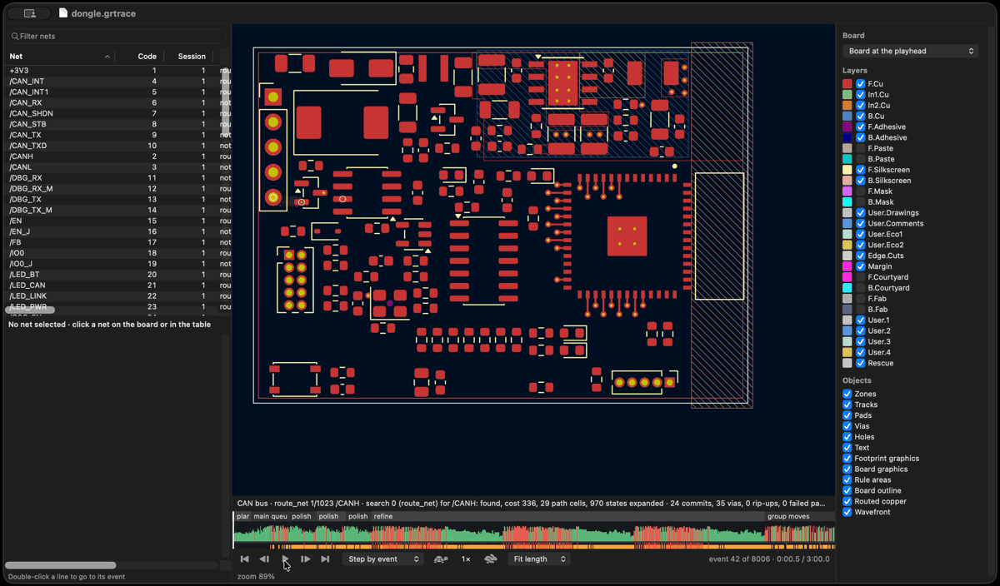
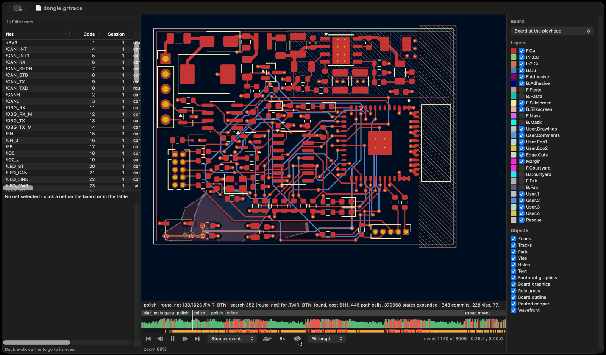
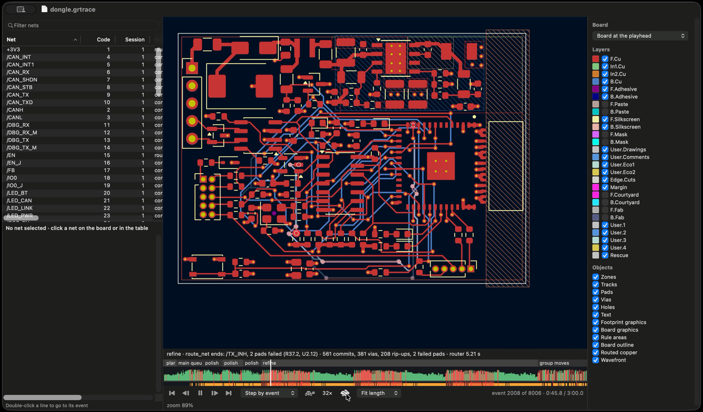
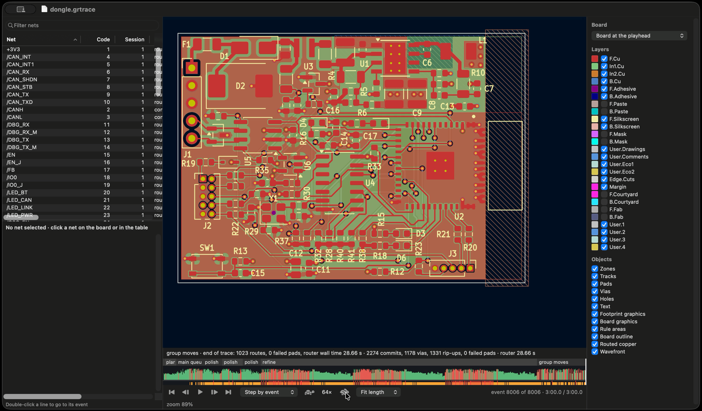

# gridrouter

A two-layer grid (maze) router for printed circuit boards, written for Python
scripts that generate KiCad boards. The A* search, the occupancy grids and
rip-up are in C; the API is plain Python. Visual Gridrouter, the macOS app in
[`viewer/`](viewer/), replays a recorded routing run search by search, or
follows one live while the router writes it.

[](docs/assets/kicadautorouter.mp4)

*Visual Gridrouter replaying the routing of the Bluetooth OBD-II dongle's
board, sped up from 1× to 64×. Click the picture for the original screen
recording (MP4, 28 s, 11.5 MB). A [shorter clip](docs/assets/kicadautorouter-small.mp4)
of the refine phase at 16× is also in the repository (MP4, 11 s, 3.4 MB).*

## Contents

- [What you are looking at](#what-you-are-looking-at)
- [Visual Gridrouter](#visual-gridrouter)
  ([what it does](#what-it-does), [build and run](#build-and-run),
  [record a trace](#record-a-trace))
- [The router](#the-router) ([quick start](#quick-start))
- [Documentation](#documentation)
- Reference: [Layout](#layout), [Build and test](#build-and-test),
  [Model](#model-unchanged-from-the-reference), [API](#api),
  [Tracing](#tracing),
  [How it works](#how-it-works-and-how-it-differs-from-the-reference)
  and its [Deviations](#deviations),
  [Test and benchmark results](#test-and-benchmark-results),
  [How the OBD-II dongle uses it](#how-the-obd-ii-dongle-uses-it),
  [Platforms](#platforms), [Where this came from](#where-this-came-from),
  [Licence](#licence)

## What you are looking at

The animation is one recorded run of the board generator of the
[Bluetooth OBD-II dongle](https://github.com/teklabsdigital/hw-obd2-dongle),
which routes its board with this library. The generator wrote a trace file
(`.grtrace`) while it ran; the app plays that file back.

- **The board** is the dongle's KiCad board after placement, written into the
  trace by `gridrouter.kicad_trace.dump_board` and drawn in KiCad's default
  colours and layer order. The panel on the right lists its layers and object
  classes.
- **Searches.** Each A* search shows as a faint tint in its layer's colour,
  spreading over the cells in the order the search expanded them (the
  wavefront). When it settles, the path it found is drawn over it.
- **Tracks committing.** Each path becomes copper: red tracks on F.Cu, blue
  tracks on B.Cu, and vias where a path changes layer.
- **Rip-up and retry.** When a net cannot get through, the router searches
  again through other nets' tracks, rips up the nets in the way and routes
  them again later. Ripped-up copper fades out; a pad that could not be
  reached gets a red marker.
- **The caption** above the timeline names the phase, the net being routed
  and what the current event does, with running counts. The phases in the
  timeline ("plane stubs", "main queue", "polish", "refine", "group moves")
  are the dongle generator's own.
- **The timeline** has one bar per search (taller when it expanded more
  states, red when it found nothing), rip-up ticks in orange, and the
  playhead.
- **The end.** The generator writes the board again after its last zone fill
  and DRC. The app then shows that "final" board, with its copper zones and
  reference designators. The caption reports 1023 route_net calls and 0
  failed pads.

## Visual Gridrouter



*A large search in progress, at 8×: the shaded area at the lower left is the
wavefront of search 352, for net /PAIR_BTN (379,968 states expanded), with the
path it found. Left: the nets table. Right: board, layers and object classes.
Below: caption, timeline and transport bar.*



*Later, in the refine phase at 32×: route_net for /TX_INH has just ended with
two failed pads (R37.2 and U2.12), each marked with a red ring. White rings
mark the pads of that route_net, and the pale tracks are copper removed by a
recent rip-up, fading out.*



*The end of the run (event 8006 of 8006): the final board as KiCad wrote it,
with zone fills on F.Cu and In1.Cu.*

Visual Gridrouter only watches: it reads trace files and never steers the
router. It does not open a `.kicad_pcb` file or route a board by itself; the
board it draws is the one the recorder wrote into the trace.

### What it does

The full list, with every key and menu, is in
[viewer/README.md](viewer/README.md) ("The app").

- **Opening.** File > Open, Open Recent, a double-click in Finder, a drop on
  the Dock icon or a window, or a path on the command line. Each trace is a
  read-only document.
- **Board.** The KiCad board stored in the trace, in KiCad 10's default
  colours and draw order. The Appearance panel shows or hides each layer and
  each object class (zones, tracks, pads, vias, holes, text, routed copper,
  wavefront and others), and picks which board to draw: by default the latest
  one at the playhead.
- **Playback and timeline.** Play, pause, play backward, step by event,
  search, commit, net, rip-up, failure or phase, and speed from 0.25× to 64×.
  Click or drag on the timeline to scrub.
- **Pacing.** Fit length (the whole run lasts 3 minutes at 1×), Nets only
  (copper commit by commit, no wavefronts), One net, Skip failed (searches
  that found nothing take no time) and Real time (the router's own timing,
  slowed down).
- **Wavefronts, ghosts and failures.** Each search's expanded cells in order,
  then its path, or its targets in red if it found none. Copper removed by a
  rip-up fades out over a moment. Failed pads keep a red marker until the
  net is tried again.
- **Nets table and highlight.** One row per net with its route_net calls,
  searches, commits, vias, rip-ups, failed pads, states expanded, router time
  and state at the playhead (routing, failed, ripped, complete, routed, not
  started). Filter and sort it. Selecting a net, in the table or by clicking
  it on the board, highlights it the way KiCad's net highlight does.
- **Per-net history.** For the selected net: each route_net call with its
  searches, commits and result, and each rip-up of its copper with what
  caused it. Double-click a line to go to that event. The net's events are
  also marked on the timeline.
- **Following a run live.** Open a trace while the router is still writing
  it, or before the file exists ("Waiting for the file"). The window follows
  the run as it grows and shows a live indicator; scrub back to look at
  something, then press Live to catch up. When the recorder finishes, the
  indicator says "Complete".
- **Status line.** The cursor position in board millimetres, the zoom and
  what is under the pointer (a pad and its net, router copper and the event
  that committed it, a wavefront cell and its cost).
- **Command-line tools.** `rvrender` draws any position of a trace to a PNG
  without a window; `rvdump` prints a trace's contents and can follow a file
  that is being written.

Platform: macOS 14 or later on Apple Silicon. That is the only client built
today. Windows and Linux clients are planned on the same portable C++ core;
they have not been built.

### Build and run

It needs only Apple's Command Line Tools (Swift 6 and clang); Xcode is not
required. From the repository root:

```sh
make -C viewer app      # builds viewer/build/Visual Gridrouter.app (swift build -c release)
make -C viewer run      # opens the app built by `make app`
make -C viewer test     # core tests, C99 header check and golden images
```

To open a trace from a terminal, or to wait for one that a run is about to
write:

```sh
"viewer/build/Visual Gridrouter.app/Contents/MacOS/RouteViewer" run.grtrace
```

A small sample trace is in the repository:
`viewer/core/tests/data/small.grtrace` (an 80 x 50 board with a rip-up, a
failed plane drop and a repeated search).

### Record a trace

Without KiCad, from the repository root:

```sh
python3 examples/record_bench.py run.grtrace --size small   # an 80 x 50 board, about 200 KB
python3 examples/record_bench.py run.grtrace                # the tests/bench.py board, 21.8 MB
```

Then open `run.grtrace` in the app. To watch the run live instead, start the
app on the path first (the command above); it waits for the file and follows
it as it is written.

In your own script, use `TracedRouter` in place of `gridrouter.Router` and
attach a `Recorder`:

```python
from gridrouter.recorder import Recorder, TracedRouter

r = TracedRouter(nx, ny, 0.1)             # the same arguments and results as gridrouter.Router
with Recorder("run.grtrace") as rec:
    rec.attach(r, nets={1: "A"})          # router net numbers to names
    rec.phase("routing")
    ...                                   # add_pad, snapshot, route_net as usual
```

Add a KiCad board with `gridrouter.kicad_trace.dump_board`. See
[Tracing](#tracing) below for the details and
[docs/TRACE_FORMAT.md](docs/TRACE_FORMAT.md) for the file format.

## The router

A grid router for printed circuit boards, rewritten from Python to C. Routing a
real 4-layer KiCad board went from 16 to 38 minutes to about 11 to 17 seconds.
On the same inputs it gives the same routes as the Python version. In the
benchmark it is about 67x faster: the whole test board takes 1.27 s instead of
84.9 s, with an identical result (see the
[benchmark table](#speed-testsbenchpy) below).

It is a two-layer grid (maze) router for Python scripts that generate KiCad
boards. It re-implements the pure-Python router that was first written inside
the board generator of the [Bluetooth OBD-II dongle](https://github.com/teklabsdigital/hw-obd2-dongle) project.
The behaviour is the same: on the same inputs it returns the same paths, costs,
rip-ups and failures, as checked by the tests. It runs about 67x faster on the
benchmark board. The
dongle's board generator now uses this library to route its real board.

The A* search, the occupancy grids, claiming and rip-up are in C
(`gridrouter/gridrouter.c`, loaded with `ctypes`). Bookkeeping and the per-net
driver logic stay in Python.

- No dependencies: standard-library Python 3.9+ and a C compiler (`cc` on macOS
  and Linux; on Windows MSVC `cl`, MinGW-w64 `gcc` or LLVM `clang`).
- Does not import `pcbnew`. The router returns plain lists of segments and vias.
  An optional helper (`gridrouter.kicad.emit`) turns them into KiCad objects.
- The shared library is compiled automatically on first use (the first
  `Router()`, or `gridrouter.build()`), and again whenever `gridrouter.c` /
  `gridrouter.h` is newer than it. On macOS it is a
  universal (arm64 + x86_64) dylib, so it loads in the system Python and in
  KiCad's bundled Python 3.9, native or under Rosetta.

### Quick start

Clone the repository (into a folder named `router` if you use it with the
dongle, see [Build and test](#build-and-test)) and run Python from its root.
The first `Router()` compiles the library.

```python
import gridrouter

r = gridrouter.Router(60, 40, 0.1)          # 60 x 40 cells of 0.1 mm
nx = r.NX

# two pads of net 1 on F.Cu (layer 0): net, layers, centre, then the pad's rectangle, in mm
r.add_pad(1, (0,), 1.0, 1.0, 0.9, 0.9, 1.1, 1.1, 0)
r.add_pad(1, (0,), 4.0, 3.0, 3.9, 2.9, 4.1, 3.1, 0)
r.snapshot()                                # everything so far becomes permanent

# each pad: (x, y, layers, [(layer, cell index)], label)
pads = [(1.0, 1.0, (0,), [(0, 10 * nx + 10)], "A.0"),
        (4.0, 3.0, (0,), [(0, 30 * nx + 40)], "A.1")]
ripped = r.route_net(1, "A", pads, False, 0)    # names of nets ripped up to make room
segments, vias = r.routes()                 # [(layer, x0, y0, x1, y1, width, net)], [(x, y, net)]
```

`gridrouter.kicad.emit` writes `segments` and `vias` into a `pcbnew` board.
The [API](#api) section lists every parameter and method.

## Documentation

- [viewer/README.md](viewer/README.md): Visual Gridrouter in full: layout,
  build and test targets, every app feature, playback, live following,
  inspecting, drawing and performance figures.
- [docs/TRACE_FORMAT.md](docs/TRACE_FORMAT.md): the trace file format,
  version 1.0, the only contract between the recorder and the viewer.
- This README's reference sections: [Model](#model-unchanged-from-the-reference),
  [API](#api), [Tracing](#tracing),
  [Deviations](#deviations) from the reference router,
  [Test and benchmark results](#test-and-benchmark-results) and
  [Platforms](#platforms).
- [CLAUDE.md](CLAUDE.md) and [viewer/CLAUDE.md](viewer/CLAUDE.md): the rules
  for AI assistants working on this repository, including the test gates
  for each kind of change.
- [examples/record_bench.py](examples/record_bench.py): a complete recording
  without KiCad.

## Layout

```
router/
  gridrouter/__init__.py    Router class, build-on-first-use, cost-table helpers
  gridrouter/gridrouter.c   C core: grids, claims, ownership / rip-up, A* search
  gridrouter/gridrouter.h   C API
  gridrouter/kicad.py       optional: write routes() into a pcbnew BOARD (pcbnew passed in)
  gridrouter/recorder.py    optional tracing: TracedRouter, Recorder, load_traced() (see Tracing)
  gridrouter/tracefile.py   trace file writer and reader, BoardWriter, check / replay, command line
  gridrouter/kicad_trace.py optional: dump a pcbnew BOARD into a trace (pcbnew passed in)
  docs/TRACE_FORMAT.md      the trace file format, version 1.0
  docs/assets/              the screen recording, animation and pictures in this README
  examples/record_bench.py  record a trace of the benchmark board (or a small one) without KiCad
  tests/ref_router.py       the oracle: the original pure-Python Router, copied unchanged (constants configurable)
  tests/common.py           random-scene helpers shared by the tests
  tests/test_search.py      C search vs oracle on random boards, every mode, both direction tables
  tests/test_ripup.py       incremental rip-up: A/B vs fresh router; full route-with-rip-up vs oracle
  tests/test_api.py         API details and error handling
  tests/test_kicad_emit.py  gridrouter.kicad.emit on an in-memory board (KiCad's Python only)
  tests/test_trace.py       trace hook vs oracle, Router vs TracedRouter, file format, reader checks
  tests/test_kicad_trace.py kicad_trace.dump_board on in-memory boards (KiCad's Python only)
  tests/run_all.py          runs all of the above
  tests/run_traced.py       runs the suite again with TracedRouter and a recorder in place of Router
  tests/bench.py            timing on a 501 x 361 grid, C vs oracle
  Makefile                  convenience targets (build, test, bench)
  viewer/                   Visual Gridrouter, a native app that replays trace files (viewer/README.md)
```

## Build and test

Nothing to install. Clone the repository into a folder named `router`, the name the dongle expects next to it. Then run any of these commands from the `router` folder:

```sh
git clone https://github.com/teklabsdigital/hw-gridrouter router
cd router

python3 -c "import gridrouter; gridrouter.build()"   # compiles the library if needed (macOS: gridrouter/libgridrouter.dylib)
make                                    # same, via make
python3 tests/run_all.py                # all tests (~1-2 min); GRIDROUTER_TEST_SCALE=0.2 for a quick run
make test-kicad                         # the same tests in KiCad's Python (includes the pcbnew emit and board dump tests)
python3 tests/run_traced.py             # the suite again with TracedRouter and a recorder (slower; see Tracing)
python3 tests/bench.py                  # benchmark; add --full-oracle to also route the whole board in Python
python3 tests/bench.py --strict         # the same with the 4-direction (GEN_PCB_STRICT=1) tables
```

Commands written as `VAR=value command` are for macOS and Linux shells. In Windows PowerShell, set the variable first, for example:

```powershell
$env:GRIDROUTER_TEST_SCALE="0.2"; python tests\run_all.py
```

The PowerShell form has not been tried.

On macOS the build command is

```sh
cc -O2 -std=c99 -Wall -Wextra -dynamiclib -arch arm64 -arch x86_64 -o gridrouter/libgridrouter.dylib gridrouter/gridrouter.c
```

The build can be changed with environment variables:

- `CC`: the compiler.
- `GRIDROUTER_ARCHS`: the architectures, default `"arm64 x86_64"`.
- `GRIDROUTER_CFLAGS`: extra flags.
- `GRIDROUTER_LIB`: where the library goes. Set this if the router folder is
  read-only, or to use a library you built yourself.

The library is written to a temporary name and then renamed, so a running
process keeps its old copy. On Linux the same code builds a `.so`
(`-shared -fPIC`). See [Platforms](#platforms) for Windows and for what has
actually been run.

## Model (unchanged from the reference)

- **Grid.** `nx` by `ny` cells with pitch `cell` mm (0.1 mm in gen_pcb.py). A
  cell is `idx = j * nx + i`, at (i * cell, j * cell) mm. There are two signal
  layers: 0 = F.Cu, 1 = B.Cu.
- **Occupancy.** Each layer has two levels. `T` marks where the centre of a
  thin track may not go. `W` does the same for a wide track or a via. A cell
  holds 0 (free), a net number (only that net may use it) or `BLOCK` = 2^30.
  When a second net claims a cell, it becomes `BLOCK`. `novia` marks cells
  where a via centre is not allowed.
- **Search.** A* from a set of `(layer, idx)` sources to a set of targets. The
  state is (layer, cell, incoming direction). Costs:
  - each step costs `STEP[layer][dir]`;
  - a bend adds `TURN[incoming][outgoing]`, and reversing is forbidden;
  - a layer change adds `via_cost`, and only where `via_ok`;
  - an optional goal heuristic `max(0, a*max(dx,dy) + b*min(dx,dy) - c)`.

  Modes:
  - `max_cost`;
  - `via_goal`: stop at the first cell where a via fits, or at a target;
  - `relax`: the path may pass cells claimed by other nets since `snapshot()`,
    at `rip_cost` per cell, but never cells claimed before the snapshot.
- **commit.** Claims discs along a path. The radii depend on the track width
  plus `power` extra cells. It records grid edges, pad stubs and vias.
  `add_via` claims both layers and marks `novia` around the via.
- **Rip-up.** `route_net` grows a tree pad by pad. If a pad cannot be reached,
  it searches again with `relax=True`, rips up the nets that own the contested
  cells, and returns their names so the caller can queue them again.

## API

```python
import gridrouter
r = gridrouter.Router(nx, ny, cell=0.1, strict=False, ...)
```

### Constructor parameters

| Parameter | Default | Meaning (reference name) |
|---|---|---|
| `nx`, `ny` | required | grid size in cells (`NX`, `NY`) |
| `cell` | 0.1 | cell pitch in mm (`G`) |
| `strict` | False | True: 4 directions, wrong-way 3.0, diagonal 1.0, heuristic 10*(dx+dy). False: 8 directions, wrong-way 1.6, diagonal 1.2, octile heuristic (`STRICT`) |
| `dirs` | from `strict` | `[(dx, dy, base cost)]` (`DIRS`) |
| `wrong_way`, `diagonal` | from `strict` | multipliers used to build `step` (`WRONG_WAY`, `DIAGONAL`) |
| `step` | built | `[[cost per dir] for layer 0, layer 1]`; layer 0 prefers x, layer 1 prefers y (`STEP`) |
| `bend_45`, `bend_90` | 12, 40 | used to build `turn` (`BEND_45`, `BEND_90`) |
| `turn` | built | `(len(dirs)+1) x len(dirs)` table, `None` = forbidden; the last row is a path start or the cell after a via (`TURN`) |
| `via_cost` | 250 | (`VIA_COST`) |
| `rip_cost`, `max_rips` | 150, 400 | (`RIP_COST`, `MAX_RIPS`) |
| `heuristic` | from `strict` | `(a, b, c)`: h = max(0, a*max(dx,dy) + b*min(dx,dy) - c); strict (10, 10, 30), else (10, 4, 30) |
| `track`, `track_wide` | 0.20, 0.50 | widths written to segments (`TRACK`, `TRACK_PWR`) |
| `r_track`, `r_wide` | (3, 5), (5, 7) | T / W claim radii in cells for a thin / wide track (hard-coded in `commit`) |
| `r_via`, `r_via_space` | (5, 7), 8 | via claim radii; radius of the `novia` disc (hard-coded in `add_via`) |
| `pad_clear` | (0.30, 0.50) | T / W pad clearance in mm, plus `cell * power` (hard-coded in `add_pad`) |
| `pad_novia` | 0.6/2 + 0.1 | `novia` margin around pads in mm (`VIA_DIA / 2 + 0.1`) |
| `edge_margin` | (0.3+0.15, 0.3+0.35) | T / W keep-out from the grid border in mm (`RULES["edge"] + ...`); `None` disables it |

`Router.for_board(width_mm, height_mm, cell=0.1, **kw)` sizes the grid the way
gen_pcb.py does: `round(w / cell) + 1` cells.

### Attributes

- `NX`, `NY`, `NC`, `G`, `BLOCK`, `START`, `DIRS`, `STEP`, `TURN`, `VIA_COST`,
  `RIP_COST`, `MAX_RIPS`, `TRACK`, `TRACK_PWR`: the constants in use.
- `T[layer][idx]`, `W[layer][idx]`, `novia[idx]`: live views of the C grids
  (ctypes arrays). They can be read anywhere. Writing is supported before
  `snapshot()`, as gen_pcb.py does for `BUCK_AREA`.
- `hardT`, `hardW`, `hard_novia`: the grids as of the last `snapshot()`.
- `edges`, `stubs`, `vias`, `padcell`, `width`, `failed`, `log`, `rips`: same
  meaning and structure as in the reference.
- `ewidth`: a property returning a copy of the reference's
  `{(net, layer, edge): width}` dict.
- `last_cost`, `last_expanded`: cost and expanded-state count of the last search.
- `skip_joined_stubs` (**new**, default `False`): when `True`, `commit` adds no
  pad stub at a path end that lands on a grid edge this net already owns on
  that layer. Such a stub would only double the connection to the pad centre.
  The dongle sets it to `True`. It changes the output, so it is off by default
  to keep the oracle results. **It has no test.**

### Methods (same names and arguments as the reference unless marked)

| Method | Notes |
|---|---|
| `claim_rect(net, layers, x0, y0, x1, y1, d_t, d_w)` | permanent claim of a rectangle in mm grown by d_t / d_w |
| `claim_disc(net, layer, i, j, r_t, r_w)` | |
| `block_rect(x0, y0, x1, y1)` | BLOCK on both layers and `novia` |
| `block_cells(layer, i0, j0, i1, j1, levels=(0, 1))` | **new**: BLOCK a cell rectangle (inclusive), same as writing `T`/`W` directly but also correct after `snapshot()` |
| `add_pad(net, layers, cx, cy, x0, y0, x1, y1, power)` | |
| `via_ok(idx, net)` | |
| `snapshot()` | everything so far becomes permanent; clears `log`, `rips` |
| `rebuild(drop)` | removes the nets named in `drop` (keys of `log`); incremental, see below |
| `rip(net)` | **new**: remove one net number's post-snapshot claims and bookkeeping |
| `owners(level, path)` | **new**, replaces the reference's `own` dict: set of nets whose post-snapshot claims cover the path cells on level 0 (T) / 1 (W) |
| `path_free(level, path, net)` | **new**: every path cell on that level is 0 or `net` |
| `search(net, sources, targets, wide, goal=None, max_cost=None, via_goal=False, relax=False)` | returns `(path or None, new_via)`; sources / targets may also be `array.array("i")` from `encode()` |
| `encode(cells)` | **new**: `[(layer, idx)]` to an encoded array (`layer * NC + idx`) |
| `commit(net, path, wide, power, end_via=False)` | |
| `add_via(net, i, j, power)` | |
| `route_net(net, name, pads, wide, power)` | returns the ripped net names |
| `drop_to_plane(net, name, pad, joined, max_cost=600)` | `max_cost` is **new** (was the literal 600) |
| `routes()` | **new**, replaces `emit`: `(segments, vias)`. `segments = [(layer, x0, y0, x1, y1, width, net)]` and `vias = [(x, y, net)]`, in mm from cell (0, 0). Collinear edges are merged and spurs dropped, as `emit` did |
| `owned_count(net)`, `search_stats()` | diagnostics |

Module-level names:

- `BLOCK`, `RouterError` (raised on bad cells, cost overflow, or relax before
  snapshot).
- `build(force=False, quiet=True)`: compiles the library if it is missing or
  older than the C source (always with `force`), and returns its path; with
  `quiet=False` it prints the compiler's warnings. `Router()` calls it on
  first use.
- `make_dirs(strict)`, `make_step(dirs, wrong_way, diagonal)`,
  `make_turn(dirs, bend_45, bend_90)`, `disc(r)`: the reference's table code.
- `gridrouter.kicad.emit(board, router, netinfo, names, pcbnew, origin=(0, 0), via_dia=0.6, via_drill=0.3)`:
  adds `PCB_TRACK` / `PCB_VIA` objects exactly as the reference `emit` did.
  It returns `(n_segments, n_vias)`.

C functions that are not part of the Python API but worth knowing:

- `rt_novia_rect(r, i0, j0, i1, j1)` marks every cell of an inclusive cell
  rectangle as "no via" permanently (clipped to the grid). `add_pad` and
  `block_rect` use it for their `novia` margins, instead of a Python loop over
  cells. It has no test of its own. It is exercised only indirectly: the
  oracle tests call `add_pad` and `block_rect` and compare the `novia` grids
  with the reference.

## Tracing

A trace is a file (`.grtrace`) that records one routing run: the router's
settings, every search with its A* wavefront (the cells it expanded, in
order, with their costs), every commit, via and rip-up, and, if you add it,
the KiCad board. Use it to see afterwards why a net failed, where a search
spent its time, or what a rip-up removed. The viewer in `viewer/` replays a
trace (see [viewer/README.md](viewer/README.md)). The file format is
[docs/TRACE_FORMAT.md](docs/TRACE_FORMAT.md).

Tracing is off unless you ask for it. `gridrouter.Router` and the default
library are unchanged: the trace hook in the C core is compiled only with
`-DRT_TRACE`, into a second library that only `TracedRouter` loads.

### Recording a run

```python
from gridrouter.recorder import Recorder, TracedRouter

r = TracedRouter(60, 40, 0.1)               # the same arguments as gridrouter.Router
nx = r.NX
with Recorder("run.grtrace") as rec:
    rec.attach(r, nets={1: "A"})            # settings, grids, net names
    rec.phase("pads")
    r.add_pad(1, (0,), 1.0, 1.0, 0.9, 0.9, 1.1, 1.1, 0)
    r.add_pad(1, (0,), 4.0, 3.0, 3.9, 2.9, 4.1, 3.1, 0)
    r.snapshot()
    rec.phase("routing")
    pads = [(1.0, 1.0, (0,), [(0, 10 * nx + 10)], "A.0"),
            (4.0, 3.0, (0,), [(0, 30 * nx + 40)], "A.1")]
    r.route_net(1, "A", pads, False, 0)
    rec.routes()                            # the result of routes(), for comparison
# leaving the block writes the END chunk and detaches the router
```

- `TracedRouter` is a `Router` subclass. It takes the same arguments and gives
  the same results, with or without a recorder (`tests/test_trace.py` and
  `tests/run_traced.py` check this). Without a recorder attached it does not
  trace. `check=True` asserts the trace invariants after every search; the
  tests use it.
- `Recorder(path)` writes one file. `attach(router, origin=(x, y), nets=...)`
  starts a session: `origin` is the board position of router cell (0, 0) in
  mm, `nets` maps router net numbers to names. Then `phase(text)`,
  `mark(text)`, `grids(label)`, `routes()`, `board(...)` and `close()`. Every
  chunk is flushed when it is written, so a viewer can follow a file that is
  still growing.
- Calls are recorded at the outermost level only: `add_pad` writes one `PAD `
  chunk, not also the `claim_rect` it makes. The format specification,
  section 5, lists what each method writes.

### The traced library

`gridrouter.recorder.load_traced()` builds and loads the traced library;
`TracedRouter` calls it. It reuses `gridrouter.build()` with `-DRT_TRACE`
added to `GRIDROUTER_CFLAGS`, so the compiler and flags are the default
library's. The file goes beside the default library:
`gridrouter/libgridrouter_trace_<hash>.dylib` on macOS (`.so` on Linux,
`gridrouter_trace_<hash>.dll` on Windows), or beside `GRIDROUTER_LIB` if that
is set. `<hash>` covers the platform, `CC`, `GRIDROUTER_ARCHS` and
`GRIDROUTER_CFLAGS`, so a change of flags builds a new file. Like the default
library, it is rebuilt when the C source is newer.

The default library is not rebuilt when only `GRIDROUTER_CFLAGS` changes
(`build()` compares file times). To test other flags, give each flag set its
own `GRIDROUTER_LIB` path in a directory that already exists.

### KiCad boards

```python
from gridrouter.kicad_trace import dump_board

stats = dump_board(rec, board, pcbnew, "placed", origin=(OX, OY), stackup=STACKUP)
```

`dump_board` writes a `pcbnew` board as one `BRD ` chunk: layers, stackup,
nets, footprints, pad shapes per layer, holes, graphics, text as glyph
outlines, zone outlines and fills, tracks and vias. It only reads the board,
and `pcbnew` is passed in, as for `gridrouter.kicad.emit`. `stackup` is a list
of `(name, thickness_mm[, er])` from top to bottom, because `pcbnew` does not
give the stackup to Python. The returned dict counts what was written, what
was approximated (arcs, circles) and what was skipped. Write a "placed" board
before routing and a "final" one after the last zone fill and DRC.
`tests/test_kicad_trace.py` tests it in KiCad's Python (`make test-kicad`).

The dongle's `gen_pcb.py` records a trace when `GEN_PCB_TRACE_FILE` is set
to an output path (on the dongle's `visual-router` branch). Unset, none of
its trace code runs.

### Without KiCad

```sh
python3 examples/record_bench.py OUT.grtrace                 # the tests/bench.py board, 21.8 MB
python3 examples/record_bench.py OUT.grtrace --size small    # an 80 x 50 board, about 200 KB
python3 examples/record_bench.py OUT.grtrace --timing        # also times Router and TracedRouter
```

These write a synthetic `BRD ` board (outline, pads, keep-outs, and the
routed tracks in the "final" board), so the viewer has a board to draw. The
small board has a rip-up, a failed plane drop and a repeated search. It is
the viewer's test sample, `viewer/core/tests/data/small.grtrace`.

### Reading a trace

```sh
python3 -m gridrouter.tracefile summary run.grtrace   # counts: chunks, searches, nets, failures
python3 -m gridrouter.tracefile dump run.grtrace      # one line per chunk
python3 -m gridrouter.tracefile check run.grtrace     # structure, ids and copper bookkeeping
```

`check` prints errors, then warnings, then one summary line. It exits 1 if
there is an error (a corrupt chunk, an id out of sequence, a bad cell, a
rip-up of copper that does not exist), and 0 for a clean file or one with
warnings only. In Python, `gridrouter.tracefile.read_trace`, `replay` (the
copper alive at any chunk) and `check` do the same.

### Size and speed

Measured on 2026-11-23 on an Apple Silicon Mac:

| Run | Without recording | With recording | Trace file |
|---|---|---|---|
| `tests/bench.py` board, `examples/record_bench.py --timing` | 1.30 s | 1.35 s (about 3 to 4 % more) | 21.8 MB |
| the dongle's board, `gen_pcb.py` | 16 s | 17 s (about 1 s more) | 145.8 MB |

Most of a trace is wavefronts, and most of those come from searches that
fail: a failed search expands every cell it can reach. A search that repeats
an earlier one exactly stores a reference instead of its wavefront. A `BRD `
chunk of the dongle's board is about 0.7 MB and took 0.13 s to write.

### What a trace does not capture

Direct writes to `T`, `W` and `novia`, anything done before `attach`,
attribute changes after it, edits of the bookkeeping lists by user code, and
calls that raise (other than `search`, `route_net` and `drop_to_plane`) are
not recorded. The format specification lists these in section 14, "What the
format does not capture". The dongle writes its direct grid writes as `mark`
notes.

### What is untested

Tracing has been run only on macOS (Apple Silicon), in Python 3.13 and in
KiCad 10's Python 3.9. The traced library has not been built on Linux or
Windows.

## How it works, and how it differs from the reference

### Same results

The C heap orders entries by `(f, d, layer, idx, dir)`, the same key the
reference pushes into `heapq`. Distances only ever strictly decrease, so no two
entries are equal. Any correct priority queue therefore pops exactly the same
sequence as the reference, which means the same paths, not just the same
costs. Ties are broken the same way and inconsistent heuristics behave the
same way. The tests check the path, cost, `new_via` and expanded-state count of
every search against the oracle.

### Speed

- **Search.** Flat arrays, with `dist` as int32 and a 1-byte predecessor code
  per state. Only touched states are reset after a search.
- **Priority queue.** One binary min-heap per f value, plus a cursor at the
  lowest non-empty f. A* pops f in nearly increasing order and many entries
  share an f, so each heap stays shallow. Pushes below the cursor are handled,
  so the order is exact for any costs. Keys with f >= 2^20 go to a single
  overflow binary heap.
- **Profiling notes.** Pop latency was most of the run time. Neither
  branch-free child selection nor a 4-ary heap helped measurably; the per-f
  buckets gave about 1.3x.

### Incremental rip-up

After `snapshot()`, every disc, path or via claim by a net is also recorded in
a per-cell linked list of owning nets and in a per-net list of cells.
`rip(net)` walks that net's list, unlinks it, and recomputes each cell from
the snapshot value and the remaining owners. This uses the same claim rule, so
the result is identical to the reference's "restore snapshot, replay every
other net". There is no copying and no replay. The tests check this against a
fresh router and against the oracle's `rebuild()`.

### Deviations

1. **Constants.** All constants are constructor parameters. Nothing is read
   from module globals or from `GEN_PCB_STRICT`; pass `strict=` instead.
2. **Output.** `emit(board, netinfo, names)` is replaced by `routes()` (plain
   data) and `gridrouter.kicad.emit(...)` (takes `pcbnew` as an argument).
   `routes()` does not modify the router. The reference `emit` pruned spurs
   from `self.edges` in place.
3. **No `snap` or `own`.** There is no `snap` attribute and no `own` dict. Use
   `owners()`, `hardT`, `hardW` and `hard_novia`. `rebuild(drop)` keeps its
   signature and result.
4. **Unlogged commits after `snapshot()`.** A `commit` / `add_via` made outside
   `route_net` after `snapshot()` belongs to its net. It is removed only when
   that net is ripped. In the reference such claims, and the `end_via` of any
   post-snapshot commit, silently vanished at the next rip-up of any net,
   because `rebuild` replays only `log` and the log has no `end_via` field.
   This looks unintended. When this library was written, it could not happen
   in the dongle's `route_all`, which called `drop_to_plane`, the fan-out
   commits and `EXTRA_VIAS` only before `snapshot()`. The dongle's code has
   changed since, so this has not been re-checked.
5. **Rectangle claims after `snapshot()`.** `claim_rect` / `add_pad` /
   `block_rect` / `block_cells` after `snapshot()` are permanent. In the
   reference they were lost at the next rip-up.
6. **Direct grid writes after `snapshot()`.** Direct writes to `T` / `W` /
   `novia` after `snapshot()` are not tracked. A later rip-up of a net that
   covers the cell recomputes it from the snapshot, so use `block_cells`
   instead. Before `snapshot()`, direct writes behave exactly as in the
   reference.
7. **`route_net` before `snapshot()`.** It skips the relaxed (rip-up)
   attempts. The reference raised `AttributeError`.
8. **`ewidth` is a copy.** It is stored per net internally; the property
   returns a fresh flat dict.
9. **Limits.**
   - At most 8192 cells per side, 16 directions, disc radius 255.
   - Path costs must stay below 2^31. A search that overflows raises
     `RouterError`; the reference used unbounded ints.
   - Cells passed in must lie inside the grid. The reference would silently
     wrap a negative index; this raises `RouterError`.
   - Costs must be non-negative, which the reference assumed too.
10. **Trace hook.** The C core has a hook that records each search's
    wavefront (`rt_trace`, `rt_trace_count`). It is compiled only with
    `-DRT_TRACE`, into the separate library that `gridrouter.recorder` builds
    (see [Tracing](#tracing)). Without that flag the machine code is the same
    as before the hook was added (checked on 2026-11-23: `otool -tv` of
    `gridrouter.c` from `main` and from this branch, compiled with
    `cc -O2 -std=c99 -c` on arm64, is identical). The hook only reads the
    search's state, so tracing never changes a result: `tests/test_trace.py`
    and `tests/run_traced.py` compare `Router` with `TracedRouter`.
11. **Duplicate source cells.** If `search` is given the same source cell
    more than once (a list or an `array`, not a set), the C core pushes it
    once and skips the copies. The reference pushes every copy into its heap
    and expands each one, so its expanded-state count is higher by one for
    each extra copy. Paths, costs and `new_via` are identical. Observed on
    2026-11-23 on a 40 x 30 grid, with one source cell and one target cell:
    with the source listed twice, the reference counted 3562 expanded states
    and C 3561 (892 and 891 with a goal); listed three times, 3563 and 3561.
    The path and the cost (282) were the same in every case. This predates
    tracing; it was found while testing the trace. `route_net` and
    `drop_to_plane` pass no duplicates, and the oracle tests pass sets, so
    neither is affected.

### Behaviour of the reference that is kept but worth knowing

- **The heuristic can be inadmissible.** It aims at the pad centre with only
  a 3-cell (30) allowance. For a target cell more than 3 cells from the
  centre (a long pad), it can overestimate, and A* may return a slightly
  costlier path than the optimum. This is reproduced exactly.
- **Ties favour smaller `d`.** Among equal f, `heapq` pops the smaller `d`,
  the state nearest the source. A* then explores a whole f-contour before
  reaching the goal. Preferring larger `d` would explore far fewer states,
  but it would change paths, so it was not done.
- **No vias through contested claims in `relax` mode.** `via_ok` still looks
  at the live W grid, so a via can never be placed through another net's
  rippable claims; only tracks can.
- **Contested sources are free.** A source cell claimed by another net after
  the snapshot is accepted in `relax` mode without `rip_cost`.
- **`width` is not restored on rip-up**, as in the reference. It only affects
  the per-net width record, which `route_all` does not use for output.

## Test and benchmark results

Measured on 2026-11-21 on an Apple Silicon Mac, Apple clang 21, `-O2`.

### Correctness

`tests/run_all.py` passes in both Python 3.13 (arm64) and KiCad's
Python 3.9.13 (arm64). A smaller run also passes on the x86_64 slice, under
`arch -x86_64`.

**Search vs oracle** (`test_search.py`). 250 random boards per direction
table. Each board is 25-90 x 20-70 cells with:

- pads of random size, layer and power;
- keep-outs and direct BLOCK writes;
- committed tracks and vias before and after the snapshot.

Each board gets 20 random searches covering all 32 combinations of
wide / goal / max_cost / via_goal / relax.

| Direction table | Searches | Found a path | Cost mismatches | Path mismatches | `new_via` / expanded-count mismatches |
|---|---|---|---|---|---|
| 8 directions | 5000 | 2704 | 0 | 0 | 0 |
| STRICT (4 directions) | 5000 | 2754 | 0 | 0 | 0 |

Every board also checks that all grids, edges, stubs, vias and widths, and
`via_ok` on sampled cells, are identical between C and oracle.

**Rip-up** (`test_ripup.py`):

- **A/B, 800 random cases.** Nets A and B are committed interleaved, with
  vias, end vias and overlapping claims; A is sometimes a net that also owns
  pads. Ripping A leaves the grids and bookkeeping identical to a fresh router
  that only committed B. Ripping B as well restores the snapshot. In 1 case in
  8 the oracle's own `rebuild()` agrees too.
- **A/B with real routing, 36 cases.** `route_net` routes both nets, then A is
  ripped. All 36 are identical to a fresh router.
- **End to end, 16 congested boards.** Each board has 6-14 nets plus a plane
  net dropped with `drop_to_plane`, routed with the `route_all` queue loop.
  That is 435 `route_net` calls and 202 rip-ups. After every call, the grids,
  bookkeeping, log order, ripped lists, failures, rip count and final
  segments / vias are identical to the oracle.

### Speed (`tests/bench.py`)

The benchmark uses a 501 x 361 grid (a 50 x 36 mm board, like the OBD-II dongle)
with 249 pads, 76 nets and an antenna keep-out. Half of the nets are routed
first as obstacles; the search timings use the first connection of each of
the other 38 nets.

| Test | Oracle (Python 3.13) | C | Speed-up |
|---|---|---|---|
| 38 thin searches | 12.88 s (232 k states/s) | 0.194 s (15.4 M states/s) | 66x |
| 38 wide searches | 11.66 s | 0.173 s | 67x |
| 38 relaxed searches | 2.62 s | 0.044 s | 60x |
| commit 77 paths | 0.051 s | 0.0011 s | 46x |
| rip-up of one net (`rebuild`) | 0.11 s | 0.00003 s | about 3400x |
| **whole board, `route_all` loop** | **84.9 s** | **1.27 s** | **67x**, identical result |
| whole board, `--strict` | 17.2 s | 0.36 s | 48x, identical result |

Strict searches are short, so fixed per-call overhead weighs more.

The reference's `rebuild` costs about 0.1 s here, and more with more nets
routed. On rip-up-heavy runs the overall gain should be higher than the 67x
of this lightly ripped benchmark.

### On the real board

On the OBD-II dongle's board, the old pure-Python router took 16 to 38 minutes
per run and often finished with 1 to 10 nets unrouted. With this library the
whole board routes in about 11 to 17 seconds, including rip-ups and the
dongle's clean-up passes. One run during development reported 779 segments, 138 vias
and 16 rip-ups in 16 s.

These numbers come from the development session logs. They are not a
controlled comparison: the board, its placement and the routing code all
changed between the two. Several of the nets that were left open by the old
router were caused by placement problems, which were found and fixed once
runs became fast.

## How the OBD-II dongle uses it

The dongle's board generator, `scripts/gen_pcb.py` in the dongle repository,
puts this folder on the import path and builds a router with its own grid,
spacings and costs. It looks for the router in a folder named `router` beside
the dongle repository, or in the folder named by the environment variable
`GRIDROUTER_PATH`. So clone this repository as `router` beside the dongle, or
set that variable (`REPO` is the dongle repository's root):

```python
sys.path.insert(0, os.environ.get("GRIDROUTER_PATH", os.path.join(REPO, "..", "router")))
import gridrouter
from gridrouter.kicad import emit as emit_routes

def make_router():
    return gridrouter.Router(
        NX, NY, G, strict=STRICT,
        wrong_way=WRONG_WAY, diagonal=DIAGONAL,
        via_cost=VIA_COST, rip_cost=150, max_rips=MAX_RIPS, bend_45=12, bend_90=40,
        track=TRACK, track_wide=TRACK_PWR,
        r_track=(3, 5), r_wide=(5, 7), r_via=(5, 7), r_via_space=8,
        pad_clear=(0.30, 0.50), pad_novia=VIA_DIA / 2 + 0.1,
        edge_margin=(RULES["edge"] + 0.15, RULES["edge"] + 0.35))
```

The dongle's defaults differ from this library's: wrong-way cost 2.0,
diagonal 1.5, via cost 400 and up to 600 rip-ups. Environment variables in
`gen_pcb.py` can change them. It also sets `skip_joined_stubs = True`.

Before `snapshot()`, `gen_pcb.py` writes the live `novia` grid directly to
route the CAN bus wires without vias. It saves the grid, fills it with the
value 2 using `ctypes.memset`, routes the two wires, then puts back every cell
that still holds 2. This relies on the rule above: direct grid writes are
exact before `snapshot()`.

Read the dongle's `scripts/gen_pcb.py` (`make_router` and `route_all`) for the current
details. This README does not track its line numbers.

## Platforms

- **macOS (Apple Silicon):** built and tested. Tests pass in Python 3.13 and
  in KiCad 10's bundled Python 3.9. A smaller run also passed on the x86_64
  slice under Rosetta.
- **Linux (untested):** the module builds `gridrouter/libgridrouter.so` with
  `$CC` (default `cc`) and `-shared -fPIC`. The Makefile does the same. This
  has never been run.
- **Windows (untested):** the module builds `gridrouter\gridrouter.dll`. It
  uses `$CC` if that is set, otherwise the first of `cl`, `gcc` and `clang`
  found on `PATH`. For `cl` (MSVC), run Python from an "x64 Native Tools
  Command Prompt" so the compiler is on `PATH`. The compiler must target the
  same architecture as your Python (64-bit for 64-bit). MSVC has no 128-bit
  integer type, so the C code then uses a two-part key that sorts in the same
  order. That code has been tested on macOS: the full test suite passes with
  it forced on (`GRIDROUTER_CFLAGS="-DRT_NO_INT128 -Werror"`). MSVC itself has
  not been tried. The DLL is copied into place, not renamed, so close other Python
  processes that have it loaded before a rebuild. You can also build the DLL
  yourself and set `GRIDROUTER_LIB` to its path. The Windows build itself
  has never been run.
  The Makefile is for macOS and Linux only.
- **Visual Gridrouter:** macOS on Apple Silicon only (see
  [Visual Gridrouter](#visual-gridrouter)); Windows and Linux clients are
  planned, not built.

## Where this came from

An AI assistant (Claude Code) wrote this library as part of an experiment in
AI-driven hardware design: the [Bluetooth OBD-II dongle](https://github.com/teklabsdigital/hw-obd2-dongle).
The dongle's first router was written in pure Python and took 16 to 38 minutes
per run. The human engineer asked for something faster. A separate AI agent
then built this library, with the Python router as its specification. The
tests compare every result with that original code, which is kept unchanged in
`tests/ref_router.py`.

The routing ideas are textbook ones: Lee / A* maze routing on a grid, rip-up
and reroute, and a preferred direction per layer. The code is original to this
project.

## Licence

MIT. See [LICENSE](LICENSE). Copyright (c) 2026 Trevor Attema, Teklabs Digital.
The licence covers the router, the trace recorder and the Visual Gridrouter
viewer (`viewer/`). The source files added with the recorder and the viewer
carry an `SPDX-License-Identifier: MIT` header.

The project contains no third-party code. It needs only the Python standard
library and a C99 compiler and, for the viewer, the C++ standard library and
Apple's system frameworks. `tests/ref_router.py` is the original Python router
from the [Bluetooth OBD-II dongle](https://github.com/teklabsdigital/hw-obd2-dongle)
project (same author, MIT). The viewer's default colours, layer names and draw
order follow KiCad's so that boards look familiar; the colour values were read
from KiCad 10.0.8, and no KiCad source code is included.

KiCad is a trademark of its respective owner. This project is not part of
KiCad and is not affiliated with or endorsed by the KiCad project. It reads
and writes KiCad boards only through KiCad's own Python API (`pcbnew`).
